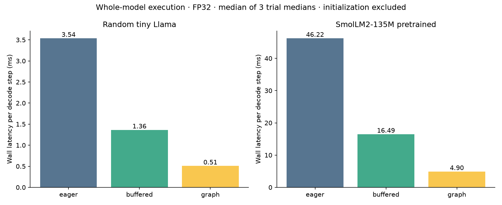

# BlockForge

A single-GPU inference runtime that connects CUDA kernels, memory ownership,
program caching, graph execution and continuous request batching.

**Research implementation:** Python host runtime; C++ CUDA kernels; explicit
cuBLAS binding for graph-safe FP32 GEMM. Tested on an RTX 4060 Laptop GPU (8 GB).
It is not a native C++ host runtime or a replacement for TensorRT-LLM.

## Measured progress

**26 tests pass**, including GPU replay with changing inputs/batches, GQA, tail
head dimensions, KV copy-on-write, page reuse, program eviction, CPU numerical
agreement, HTTP JSON responses and server-sent token events.

On the recorded SmolLM2-135M decode workload, the median of three trial medians
was **46.224 ms/step eager**, **16.492 ms buffered**, and **4.904 ms graph replay**:
**9.43x** between the two endpoints, with identical generated tokens. This is
FP32, batch 1, prompt length 16, 16 decode steps, excluding initialization,
compilation and prefill. It is a comparison of this project's execution modes,
not superiority over a vendor runtime or a general LLM speed claim.



[Full expansion results](results/expansion/RESULTS.md) | [Raw measurements](results/expansion/measurements.json) |
[HTTP load data](results/expansion/http-load.json) | [Test log](results/expansion/tests.txt)

The original experiments remain archived in [the baseline report](results/RESULTS.md).
They used the original eager runtime and a different toy serving workload.

## System layers

| Layer | Executable responsibility |
|---|---|
| Request service | Bounded admission, one GPU-owning worker, JSON/SSE output, cancellation and metrics |
| Scheduler | Continuous batching, decode-first policy, bounded prefill allowance, memory reservations |
| Execution programs | Batch signatures, runtime argument rebinding, bounded LRU cache, stable intermediate buffers |
| Device runtime | Compute/transfer streams, events, pinned host staging, deferred resource retirement primitive |
| Memory | Paged KV ownership, physical write slots, reference counting, partial-page copy-on-write, usage reports |
| Operators | Embedding, RMSNorm, RoPE/KV scatter, paged attention, fused residual normalization, SwiGLU, GEMM |
| Profiling | Host Chrome traces, separate CUDA-event durations, optional NVTX, compiler resource attributes |

The expansion follows an inspection of TT-Metal/TTNN's separation of programs,
command queues, events, buffers and operators. [Research notes](docs/TT_METAL_STUDY.md)
link the inspected source at a fixed revision and explain the CUDA analogues.

## CUDA concepts with code behind them

- **CUDA Graph capture/replay:** the complete forward pass, including all GEMMs
  and custom kernels, is captured in `runtime/execution.py`.
- **Runtime argument rebinding:** tokens, sequence positions, block tables and
  physical write slots change without rebuilding graph nodes.
- **Pinned staging and stream dependencies:** transfer events order compute and
  protect host buffers from being overwritten during DMA.
- **Kernel fusion:** K RoPE plus cache scatter; residual-add plus RMSNorm; SwiGLU.
- **Warp shuffles:** warp-local QK reductions replace token-by-token CTA barriers.
- **Split-KV reduction:** independent context partitions merge with a stable
  log-sum-exp rule. See the measured parameter sweep; the model graph currently
  uses one partition per query head.
- **Workspace/program lifetime:** stable device addresses, sealed workspaces,
  bounded program caches and completion-aware eviction.

There is no claim of Tensor Core attention, TMA, WGMMA, measured occupancy,
measured hardware bandwidth or multi-GPU execution. Compiler register attributes
are reported separately from hardware profiler measurements.

## Setup

Python 3.12 was used. From this directory:

```powershell
python -m venv .venv
.venv\Scripts\Activate.ps1
python -m pip install -r requirements.txt
```

CPU toy inference needs NumPy. Checkpoint tests use safetensors; pretrained text
uses tokenizers; plot generation uses matplotlib.

CUDA needs compatible driver, NVRTC, runtime and cuBLAS libraries. `nvcc` is not
required because CuPy runtime-compiles the CUDA sources. The exact tested versions
are in `requirements-tested.txt`. On this Windows machine the toolkit libraries
were installed using the NVIDIA CUDA 12.4 runtime/NVRTC/cuBLAS pip wheels; the
backend locates their DLL directories. Use versions appropriate to your machine.
Actual driver/runtime reports are retained in the results JSON.

## Run inference

```powershell
python -m runtime --device cpu --tokens 1,2,3 --max-new-tokens 8
python -m runtime --device cuda --execution eager --tokens 1,2,3
python -m runtime --device cuda --execution graph --tokens 1,2,3
```

Toy weights are random; their token IDs are not meaningful language. For a real
model, provide a compatible local Llama checkpoint or explicitly download the
public example (~270 MB; consult its model card/license):

```powershell
python scripts/download_example.py
python -m runtime --device cuda --execution graph --checkpoint checkpoints/SmolLM2-135M --prompt "The capital of France is" --max-new-tokens 16 --pages 16
```

The original pretrained smoke output and checkpoint hashes are in `results/`.
Weights are excluded from Git. Standard Llama configurations with even head
dimensions <=256 are supported. Scaled RoPE, projection biases, nonstandard head
dimensions, quantized checkpoints and non-SiLU activations are rejected. Storage
FP16/BF16 is converted to FP32 execution. The text CLI accepts one EOS ID.
Checkpoint/model execution has not been checked against Transformers as an
independent framework; the tests include an independent NumPy dense model path.

The CLI accepts `--requests` with a JSON list of token-ID requests:

```json
[
  {"key":"short", "prompt":[1,2,3], "max_new_tokens":8},
  {"key":"later", "prompt":[4,5,6,7], "max_new_tokens":8, "arrival_s":0.05}
]
```

```powershell
python -m runtime --device cuda --execution graph --requests requests.json --policy decode_first --token-budget 2
```

## Serve concurrent requests locally

```powershell
python -m runtime.service --device cuda --execution graph --port 8080
```

POST `http://127.0.0.1:8080/generate` with:

```json
{"tokens":[1,2,3],"max_new_tokens":8,"stream":true}
```

`stream:true` returns SSE token/done events; otherwise the response is JSON.
`/health` and `/metrics` report worker status. HTTP threads never access CUDA.
The server uses token IDs, not an OpenAI-compatible chat schema, and binds to
loopback. This is a local research service, without a production authentication,
TLS or distributed routing layer.

## Reproduce tests and measurements

```powershell
python -m unittest discover -s tests -v
$env:RUN_CUDA_TESTS="1"
python scripts/validate.py
python -m benchmarks.expansion
python -m benchmarks.service_load
python -m benchmarks.report_expansion
```

Unset `RUN_CUDA_TESTS` for the CPU suite. GPU tests explicitly requested but unable
to initialize fail rather than silently skipping. CPU GitHub Actions runs on push;
the manual GPU workflow requires a configured self-hosted GPU runner.

The expansion records three decode/scheduler trials and twenty event samples per
attention candidate. HTTP data is one exploratory loopback run per mode. Plot
scripts read actual JSON samples. Warmup/capture costs are excluded from the
reported steady-state decode experiments; complete request timings include
metadata, scheduling and output processing as described in each report.

`results/expansion/trace.json` contains host Chrome-trace intervals and separate
CUDA-event durations. Host/device clocks are not calibrated, so GPU timeline
positions are not fabricated. `BLOCKFORGE_NVTX=1` enables NVTX ranges when the
local NVTX libraries are installed. Nsight and Compute Sanitizer were not run
here. See [runtime invariants and profiling](docs/RUNTIME.md).

## Scope and remaining work

Prefill still consumes prompt tokens sequentially. The graph path removes dispatch
work and fuses operations; it does not implement parallel FlashAttention prefill.
Other remaining work includes reduced-precision/Tensor Core attention, automatic
prefix lookup, adaptive partition dispatch, true transfer/compute overlap across
requests, multi-GPU and native C++ hosting. The deferred-retirement primitive is
tested; model page release still waits for completion before recycling memory.

## History provenance

This repository was implemented with AI assistance on October 29, 2026.
At the user's request, its **40 non-empty commits** use a reconstructed timeline
from **September 23 through October 29, 2026**. The changes were split from the
existing implementation history; these dates do not establish days worked or
manual authorship. Every commit labels the reconstruction. Benchmark execution
timestamps and results remain unchanged. `docs/HISTORY_REWRITE.json` maps the
original stage commits to the reconstructed history for provenance.

The code is pushed to `nehanmohammed19/BlockForge`; model weights and local
credentials are not tracked.

## References

- [TT-Metal/TTNN](https://github.com/tenstorrent/tt-metal): runtime architecture study.
- [PagedAttention](https://arxiv.org/abs/2309.06180): page-based KV memory management.
- [FlashInfer](https://arxiv.org/abs/2501.01005): attention execution and scheduling.
- [FlashAttention-3](https://arxiv.org/abs/2407.08608): advanced asynchronous pipelines.

These are conceptual foundations; this project does not reproduce their complete
algorithms or published performance.
