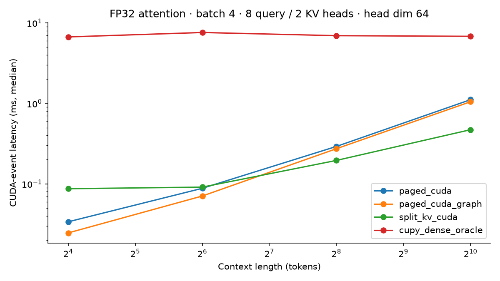
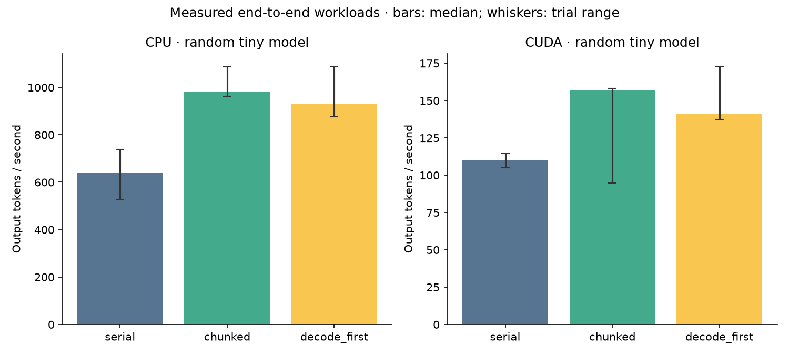
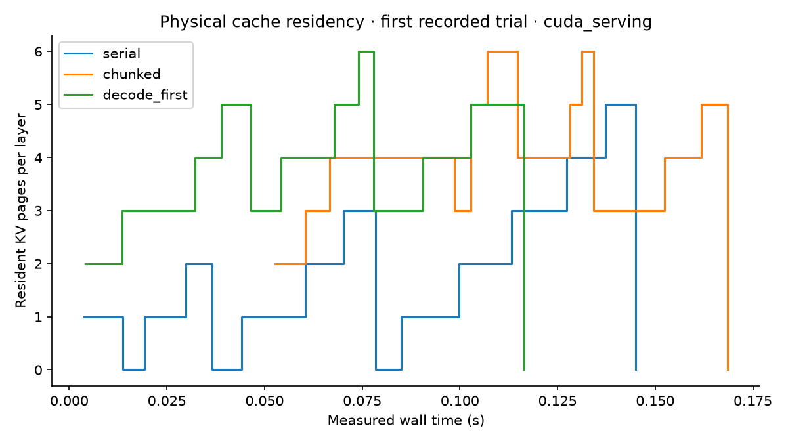

# Measured results

Measured at: 2026-10-30T01:11:08.481967+00:00.
GPU: NVIDIA GeForce RTX 4060 Laptop GPU. Precision: FP32.

## Attention microbenchmark

Batch 4, 8 query heads, 2 KV heads, head dimension 64. Times are CUDA-event
medians over 15 samples after 3 warmups. Page metadata and split workspace
are preallocated; preparation and allocation are excluded. The dense CuPy
oracle includes gather/materialization and is a correctness baseline, not
a competitive FlashAttention/cuDNN baseline.

| Context | Initial CUDA (ms) | Graph replay (ms) | Split-KV (ms) |
|---|---:|---:|---:|
| 16 | 0.0338 | 0.0246 | 0.0870 |
| 64 | 0.0881 | 0.0707 | 0.0911 |
| 256 | 0.2918 | 0.2734 | 0.1956 |
| 1024 | 1.1121 | 1.0486 | 0.4710 |

## Full runtime workload

Random two-layer toy Llama, hidden size 64; four requests arriving at time
zero with prompt lengths 1/4/8/16 and four output tokens each. Three trials.
Token budget 2, prefill chunk 4, maximum 8 active requests. Wall time includes
scheduling, metadata, model execution and synchronization.
These numbers do not establish pretrained-model quality or realistic LLM throughput.

| Device | Policy | Median output tokens/s | Median trial p95 TTFT (ms) | Median trial p95 ITL (ms) |
|---|---|---:|---:|---:|
| cpu | serial | 641.70 | 21.40 | 0.81 |
| cpu | chunked | 981.02 | 14.24 | 2.50 |
| cpu | decode_first | 931.50 | 14.75 | 1.11 |
| cuda | serial | 110.33 | 124.13 | 4.91 |
| cuda | chunked | 157.12 | 83.82 | 12.27 |
| cuda | decode_first | 140.89 | 93.60 | 7.59 |

## Interpretation and limits

- Split-KV trades an extra launch and workspace for more parallelism over long contexts.
- CPU wins on this tiny model. GPU speedups over CPU are not claimed.
- Policy comparisons require more workloads and trials; execution order and laptop clocks can influence these samples.
- Three burst-workload trials and four requests are exploratory, not statistical evidence of production tail latency.
- Graph replay covers attention only. Whole-model capture and host/device overlap are not implemented.
- Page reservations use worst-case request lengths to prevent allocation deadlock; this can underutilize capacity.
- Prefix fork/copy-on-write is tested at the allocator level, not wired to a global prefix lookup service.
- No Tensor Core attention, FP16/BF16 execution, quantized KV, multi-GPU, or speculative decoding claim.
- Nsight and Compute Sanitizer have not been run on this machine.
- Raw measurements include source hashes, environment and actual timestamps; commit dates are reconstructed.
