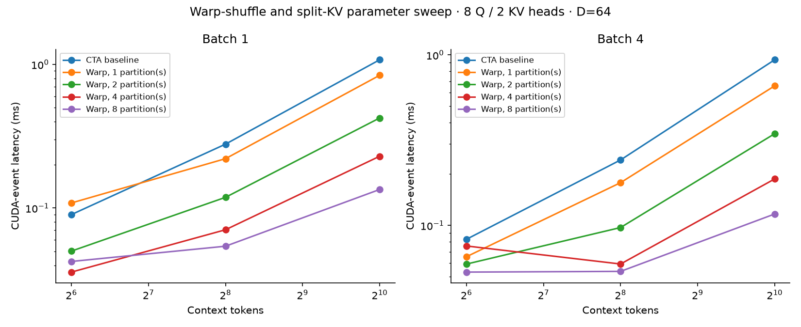
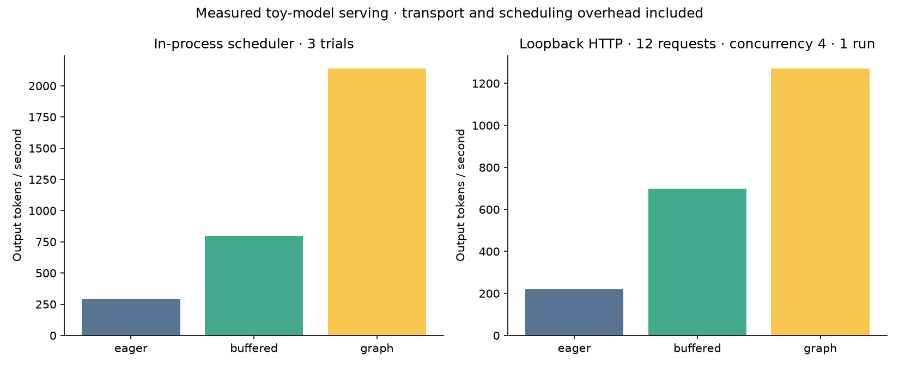

# Runtime expansion results

Measured: 2026-10-30T01:26:13.032263+00:00.
Device: NVIDIA GeForce RTX 4060 Laptop GPU. CuPy 14.2.0. Precision FP32.

## Whole-model decode

Batch 1; 16 decode steps per trial; 3 trials. Table values are the median
of trial medians. Wall time includes host metadata preparation, pinned
uploads, GPU execution, greedy selection and synchronization. Weights
upload, compilation/capture, library startup and prompt processing are
excluded. Pretrained model uses a deterministic token-ID prompt of length
16. Timing is conditional on this small model and workload, not all LLMs.

| Model | Prompt | Eager ms | Buffered ms | Graph ms | Eager / graph |
|---|---:|---:|---:|---:|---:|
| random tiny | 8 | 3.537 | 1.362 | 0.507 | 6.97x |
| random tiny | 64 | 3.894 | 1.769 | 0.525 | 7.42x |
| SmolLM2-135M | 16 | 46.224 | 16.492 | 4.904 | 9.43x |

## What changed

- Buffered execution uses stable intermediates, a dedicated cuBLAS handle, fused RoPE/KV scatter, residual RMSNorm and SwiGLU.
- Graph execution captures the complete forward pass, including all library GEMMs and custom kernels. Runtime token/position/page inputs are rebound without recapture.
- The scheduler uses a bounded batch-signature program cache, so changed request identities reuse programs.
- Program workspaces, pinned staging, KV residency and compiler-reported kernel resources are present in the raw reports.
- All compared execution modes generated identical tokens on the recorded workloads. The pretrained loader has not been compared against the Transformers framework.

## Attention parameter sweep

Twenty CUDA-event samples after three warmups per candidate; identical FP32
inputs. Workspace allocation and metadata preparation excluded. Every
candidate is checked against the original CTA implementation before timing.
This is a parameter sweep, not an automatically trained tuning model. The
whole-model graph path currently uses one warp partition per query head.

## Serving experiments

In-process: prompts 1/4/8/16, eight output tokens per request, token budget
4, decode-first scheduling; three trials. Every batch size is warmed first.
HTTP: twelve requests, concurrency four, same prompt family/output count,
one exploratory run per mode on loopback. No external load generator or
network transit is involved. These are random toy-model workloads.

| Mode | In-process median tokens/s | HTTP tokens/s | HTTP p95 request ms |
|---|---:|---:|---:|
| eager | 292.6 | 219.4 | 266.69 |
| buffered | 795.2 | 697.7 | 63.36 |
| graph | 2138.5 | 1270.6 | 33.29 |

## Profiling and interpretation

`trace.json` contains actual host Chrome-trace intervals and separately
labeled CUDA-event durations. GPU clocks are not aligned to host timestamps;
no synthetic GPU timeline is drawn. Enable `BLOCKFORGE_NVTX=1` on a machine
with NVTX support to add Nsight-visible ranges. Nsight and Compute Sanitizer
were not installed/run here; register counts in the report are compiler
attributes, not measured occupancy or stall counters.

The buffered-versus-eager comparison changes both fusion and execution
infrastructure, so it cannot attribute gains to one kernel. Graph-versus-
buffered is a closer comparison of dispatch paths but also changes host
wrapper overhead. Laptop clocks, WDDM scheduling, trial order and background
activity can influence results. No vendor-kernel or production-serving
performance superiority is claimed.

Remaining gaps: parallel prefill, reduced-precision/Tensor Core attention,
automatic prefix lookup, adaptive split dispatch, multi-GPU and a native
C++ host runtime. Transfer/compute queues have explicit event dependencies;
these experiments do not establish cross-request transfer/compute overlap.

Reproduce: `python -m benchmarks.expansion`, `python -m benchmarks.service_load`,
then `python -m benchmarks.report_expansion`. Raw JSON preserves timestamps,
software details, samples, output tokens and measured-source hashes.
